# Mossgrove for Android: an NthCase sample app

Mossgrove is a small, fictional shop for home and desk goods. It is built to be tested with
[NthCase](https://nthcase.com), the AI testing platform that records and replays tests on Android, iOS and the web.
Clone it, build it, and run your first NthCase test on it in minutes.

It is one of five identical Mossgrove apps. The same screens, test ids, texts and scenarios are built in Kotlin +
Jetpack Compose (this one), SwiftUI, Flutter, React Native and Ionic, all from one spec: [SPEC.md](SPEC.md),
**spec 1.0**. Every verb NthCase supports has a place to land, and so do the hard cases real apps have: a slow screen,
a failed load with retry, a web view, a system permission prompt, a modal, and a screen with no test ids at all.

- No network, no analytics, no ads, no tracking, no third-party SDKs. Everything is seeded inside the app, so every run
  is the same.
- One screen, Settings, is built with classic **XML Views and a Fragment**, so both Android UI toolkits are covered.

| Sign in | Shop | Item | Cart |
| --- | --- | --- | --- |
| 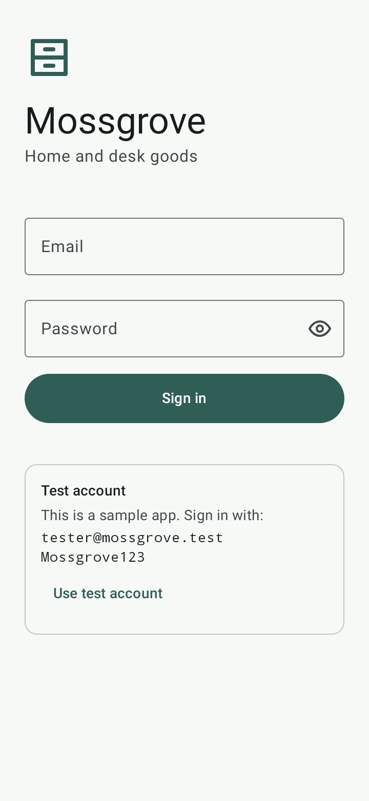 | 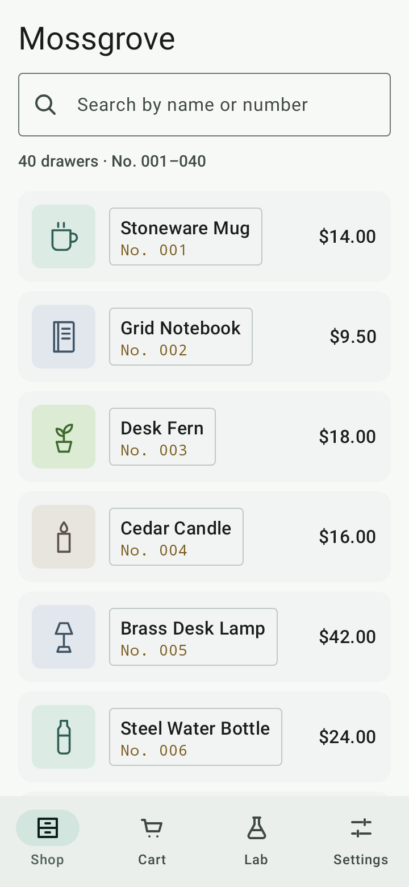 | 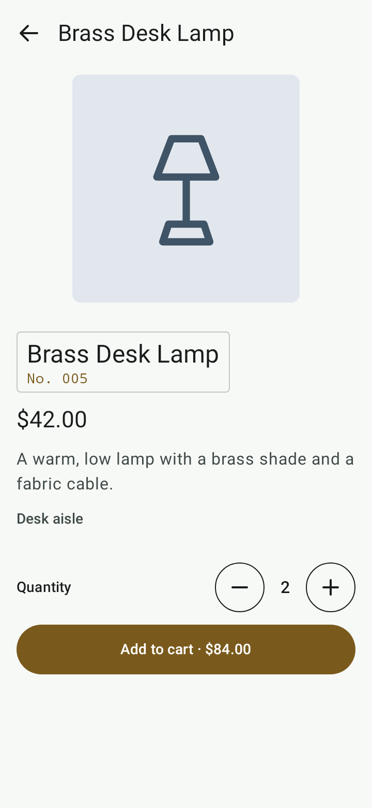 | 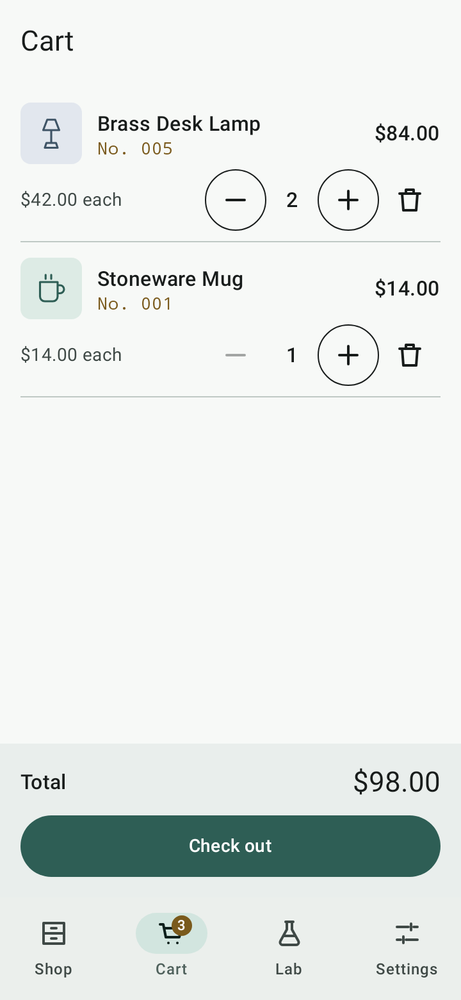 |
| Modal | Lab | Form errors | Form done |
| 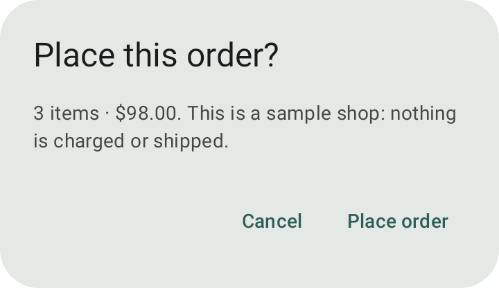 | 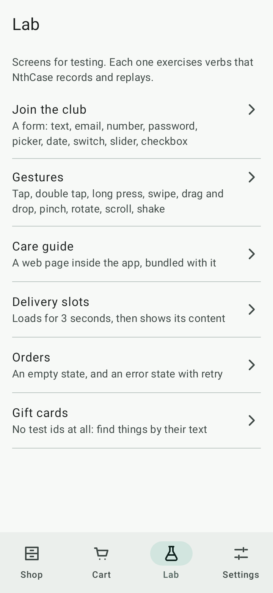 | 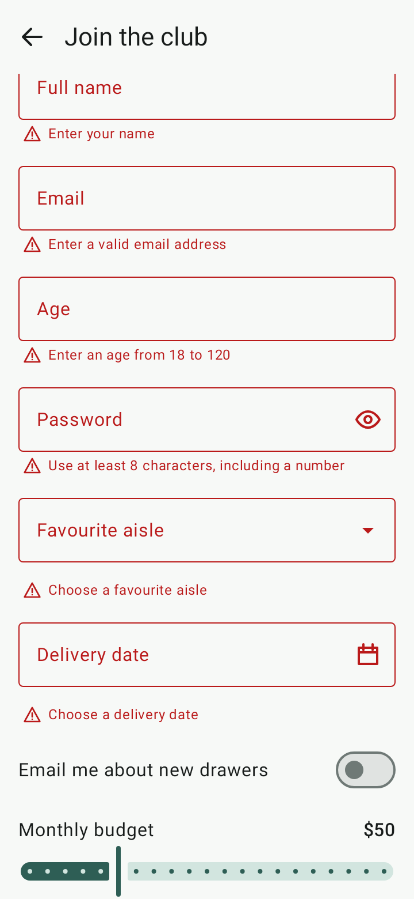 | 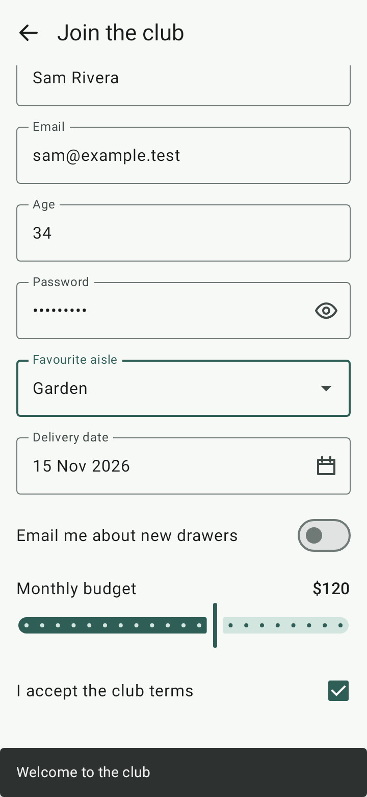 |
| Gestures | Delivery slots | Error + retry | No test ids |
| 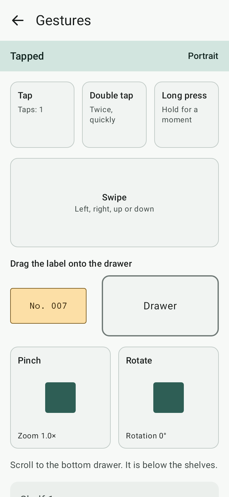 | 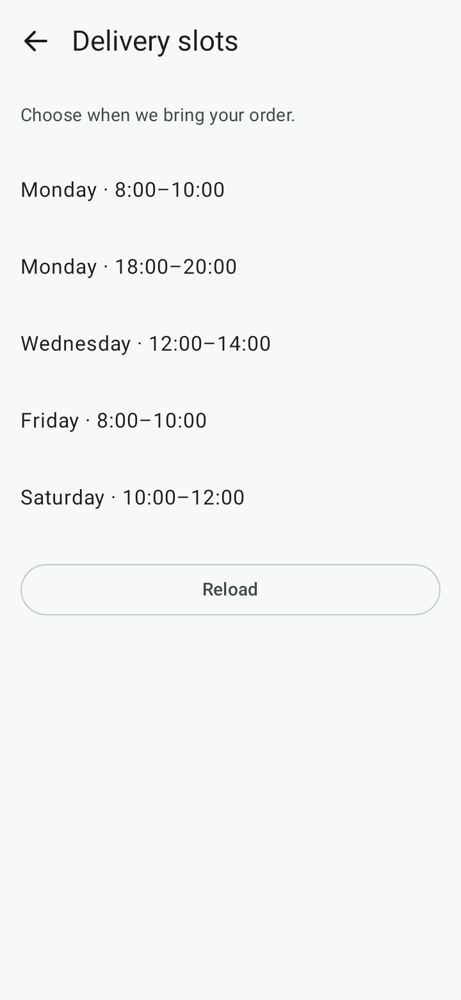 | 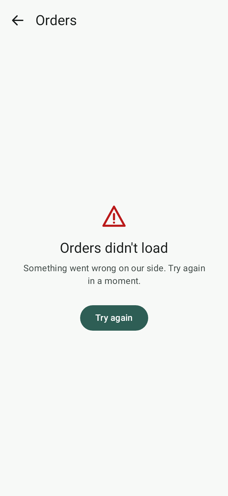 | 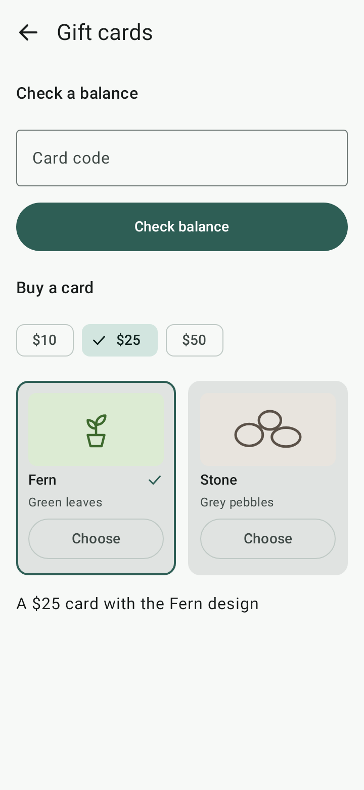 |
| Settings (XML) | XML dialog | Empty search | Deep link, unknown id |
| 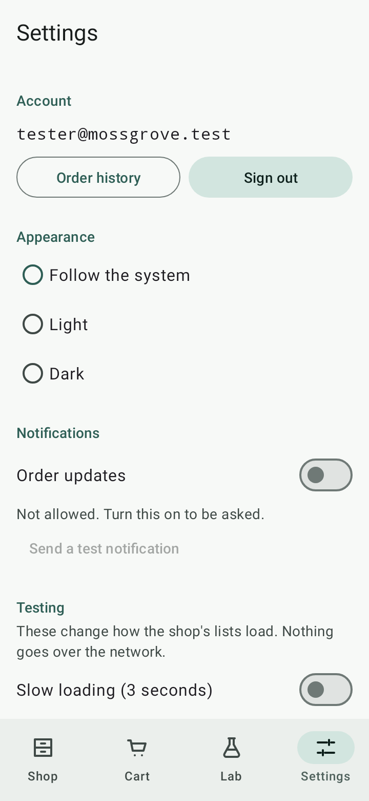 | 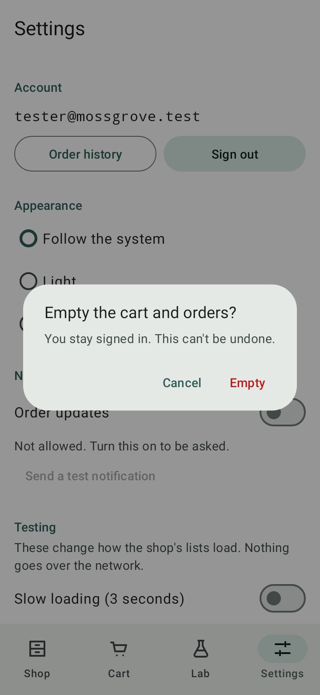 | 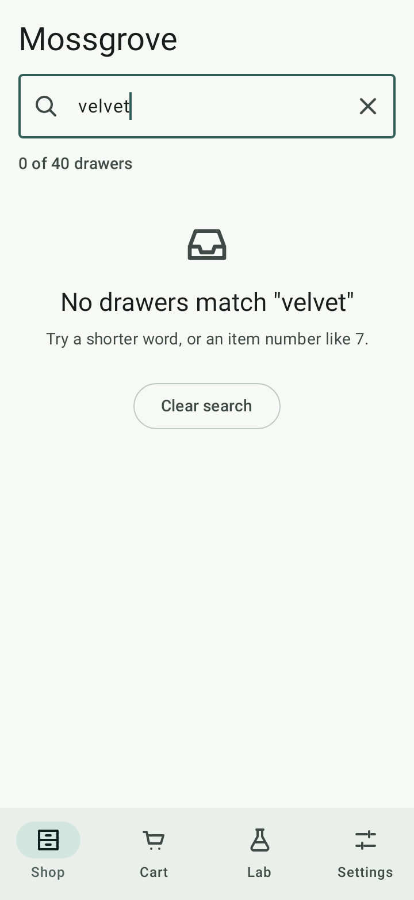 | 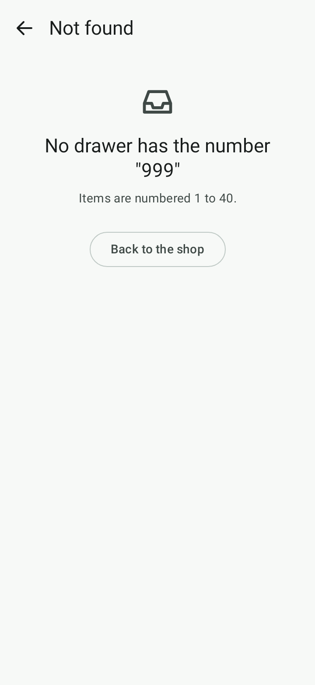 |

All 24 screens, light and dark, are in [docs/screenshots](docs/screenshots). They are drawn on the JVM by the tests
(Robolectric), not on a device.

## Test account

| | |
| --- | --- |
| Email | `tester@mossgrove.test` |
| Password | `Mossgrove123` |
| Gift-card code | `MOSS-0025` |
| Deep link | `nthcase-sample://item/{1–40}` |
| Package | `com.nthcase.sample` |

The account is printed on the sign-in screen too, with a **Use test account** button.

## Build

You need JDK 17 or newer (21 is what CI uses) and the Android SDK (`ANDROID_HOME`, or `sdk.dir` in
`local.properties`). The Gradle wrapper fetches everything else.

```bash
./gradlew assembleDebug
```

The APK is `app/build/outputs/apk/debug/app-debug.apk`. It is debug-signed, about 18 MB (an unminified debug
build). Every [release](../../releases) also has a ready-built one.

```bash
./gradlew testDebugUnitTest
```

This runs the unit tests and the Compose UI tests on the JVM with Robolectric: no emulator. They check every spec id
on its screen, in the accessibility tree Appium reads. They play the scenarios' flows, and draw the screenshots.
`./gradlew updateScreenshots` copies the pictures into `docs/screenshots`. One instrumented smoke test is in
`app/src/androidTest` for an emulator or device of your own: `./gradlew connectedDebugAndroidTest`.

| | |
| --- | --- |
| Language and UI | Kotlin, Jetpack Compose, Material 3, Navigation Compose; Settings in XML Views + Fragment (Material Components) |
| SDK | minSdk 26 (Android 8.0), targetSdk and compileSdk 37 (Android 17) |
| Build | Gradle 9.8.2 (wrapper), Android Gradle Plugin 9.5, Kotlin 2.4, version catalog in `gradle/libs.versions.toml` |
| Tests | JUnit 4, Robolectric 4.17, Compose UI test |
| Permissions | `POST_NOTIFICATIONS` only. No `INTERNET`: the app cannot reach the network. |

## Test it with NthCase

1. Install the APK on an emulator or a test phone: `adb install app/build/outputs/apk/debug/app-debug.apk`.
2. Connect the device to NthCase with the agent: `npx nthcase-agent@latest`. The NthCase docs, under *Your
   devices*, walk through it. Or use a cloud device.
3. In NthCase, add an Android app with the package `com.nthcase.sample`, and upload the APK as its build.
4. Create a scenario from one of the files in [nthcase/scenarios](nthcase/scenarios): its numbered lines are the
   steps, and each `Expect:` line is that step's check. Or record one: **Scenarios → New scenario → Record**.
5. Compile it, and run it.

With NthCase's MCP server, ask your assistant to "create a scenario from nthcase/scenarios/03-cart-and-order.md for
Mossgrove and run it on my Android phone".

## What it covers

| NthCase verb | Where | Scenario |
| --- | --- | --- |
| launch, tap, type | sign in, search, every button | 01, 02 |
| scroll to an element, swipe | the 40-item list; the form; the gestures screen | 02, 04, 05 |
| doubletap, longpress, pinch, dragdrop | Lab › Gestures | 05 |
| slide, select | Lab › Join the club (slider, dropdown, date picker) | 04 |
| rotate, lock, unlock, home, back | any screen | 06 |
| a web view | Lab › Care guide (a bundled page) | 07 |
| waitFor, an error with retry, empty states | Lab › Delivery slots, Lab › Orders, Settings › Testing | 08 |
| a system permission prompt, a modal, XML Views | Settings | 09 |
| a screen with no test ids | Lab › Gift cards | 10 |
| extract, startif / endif | the cart total; sign in only if asked | 03, 06 |
| deep link | `nthcase-sample://item/7` | 11 |

The full table, with every check type and the known gaps, is in [SPEC.md §8](SPEC.md#8-verb-coverage).

## Test ids

Every control has a stable test id from one list shared by all five apps: [nthcase/test-ids.json](nthcase/test-ids.json).
In Compose they are `Modifier.testTag` with `testTagsAsResourceId`, so Appium sees `resource-id="shop_search"`. On
the XML Settings screen they are `android:id`, so Appium sees `resource-id="com.nthcase.sample:id/settings_reset"`.
The care-guide page's elements have the same HTML `id` and `data-testid`. The Gift cards screen has none, on purpose.

## Layout

```
app/src/main/java/com/nthcase/sample/   MainActivity, TestIds, data/, ui/ (Compose screens), settings/ (the Fragment)
app/src/main/res/layout/                fragment_settings.xml, dialog_reset.xml: the XML screen
app/src/main/assets/web/                care-guide.html, the web view's page
app/src/test/                           JVM tests: data, spec ids, screens, flows, deep link, screenshots
app/src/androidTest/                    one instrumented smoke test
art/                                    the original icons, product drawings and launcher mark (SVG)
nthcase/                                test-ids.json and the scenarios
docs/screenshots/                       every screen, light and dark
```

## CI

Every run is one job on `ubuntu-latest`: the unit tests and the Robolectric UI tests on the JVM, and the APKs, in 1 to
5 minutes. Android has no device suite: no test here needs an emulator. It runs on a push to `main`, on a pull
request, on "Run workflow", at 03:17 UTC on the 1st of each month, and before every release: a `v*` tag publishes only when it is
green. A push that changes only `README.md`, `CONTRIBUTING.md`, `SECURITY.md`, `DESIGN.md`, `LICENSE`, `NOTICE` or
`docs/screenshots/` starts nothing. To run it by hand, open Actions → build → Run workflow on `main`, or run
`gh workflow run build.yml --ref main`. The job is in [.github/workflows/ci.yml](.github/workflows/ci.yml).

## Licence

Apache-2.0, see [LICENSE](LICENSE) and [NOTICE](NOTICE). Mossgrove, its items and its drawings are fictional and were
made for these apps. "NthCase" is a trademark of Unidots Software Solutions LLC.
